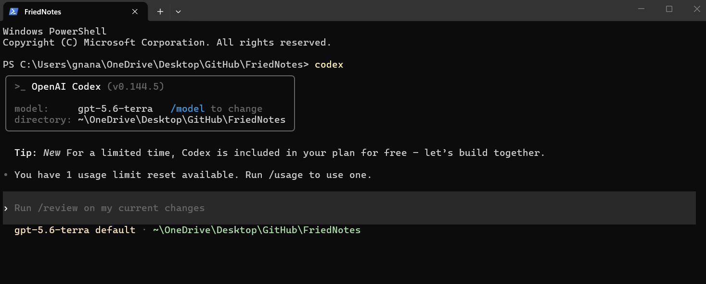

Codex is OpenAI's coding agent for the terminal. It reads the files in your project, proposes changes, edits files and runs commands, and it asks for your approval before it acts outside the limits you set.

This guide shows you how to install Codex on Windows, sign in, run a first task and set it up for documentation work in a docs-as-code repository.

{: width="600" }

> This guide is part of a series. For the concepts behind agent-based writing, see [Using AI agents for technical writing](./Using_AI_Agents_for_Technical%20Writing.html). For ready-made prompts, see the [prompt library](./Prompt_Library.html).

## Before you begin

Make sure that you have the following:

| Requirement | Details |
|---|---|
| Windows version | Windows 11 is recommended. Windows 10 version 1809 or later works on a best-effort basis. |
| OpenAI access | A ChatGPT Plus, Pro, Business, Edu or Enterprise plan, or an OpenAI API key. |
| Git | Recommended. Codex works best in a Git repository, because you can review and undo its changes. |
| Node.js | Needed only if you install Codex with npm. |

To check whether Git is installed, run this command in PowerShell:

```powershell
git --version
```

If the command returns a version number, such as `git version 2.47.0`, Git is installed.

## Install Codex

Open PowerShell and run the official install script:

```powershell
powershell -ExecutionPolicy ByPass -c "irm https://chatgpt.com/codex/install.ps1 | iex"
```

The script downloads Codex and adds it to your path. When it finishes, close PowerShell and open a new window so the change takes effect.

**Alternative: install with npm.** If you already use Node.js, you can install Codex as a global npm package instead:

```powershell
npm install -g @openai/codex
```

## Verify the installation

In a new PowerShell window, run:

```powershell
codex --version
```

The command prints the installed version. If PowerShell reports that `codex` isn't recognized, see [Troubleshooting](#troubleshooting).

## Sign in

1. Go to a project folder. For example:

   ```powershell
   cd C:\Projects\my-docs
   ```

2. Start Codex:

   ```powershell
   codex
   ```

3. When Codex asks how to sign in, choose **Sign in with ChatGPT**. Your browser opens.
4. Sign in to your ChatGPT account and approve access. Then return to the terminal.

To use an API key instead of a ChatGPT plan, follow the [authentication steps in the Codex docs](https://developers.openai.com/codex/auth). API usage is billed to your OpenAI API account.

## Run your first task

With Codex open in your project folder, describe what you want in plain language. Start with a read-only request, so you can see how Codex explores the project before you let it edit anything:

```text
Tell me about this project. List the main folders and what each one contains.
```

Codex reads the files and answers in the terminal. Then try a small edit:

```text
Find spelling mistakes in docs/Mermaid_User_Guide.md and fix them.
```

Before Codex changes a file or runs a command that needs approval, it shows you what it plans to do. Read the proposal, then approve or decline it.

When the task is done, review the changes with Git:

```powershell
git diff
```

If you don't want a change, discard it with `git restore <file>`.

## Give Codex your project rules

Codex follows the instructions in an `AGENTS.md` file at the root of your project. For a documentation repository, this is where you put your style rules, so that every task follows them without your having to repeat them.

To create the file, run this command inside Codex:

```text
/init
```

Codex creates an `AGENTS.md` file based on your project. Edit it to add your own rules. For example:

```markdown
# Instructions for Codex

- Follow the Google developer documentation style guide.
- Use sentence case for headings.
- Write in second person and active voice.
- Put new pages in the docs/ folder and add them to the sidebar in docs/_layouts/docs.html.
- Don't change files in .github/ unless I ask.
- After editing Markdown, run `vale docs` and fix any errors.
```

## Control what Codex can do

Codex runs commands in a sandbox that limits what it can change without asking. To see or change these limits, run `/permissions` inside Codex.

Keep the default permissions until you're comfortable with how Codex works. Commit your work before you start a large task, so you can roll back with Git if needed.

On Windows, Codex runs natively in PowerShell with its own Windows sandbox, so you don't need WSL. If your tools only run on Linux, or your workflow already uses WSL2, you can run Codex inside WSL instead. For sandbox details, see [Windows sandbox](https://developers.openai.com/codex/windows) in the Codex docs.

## Useful commands

Run these slash commands inside a Codex session:

| Command | What it does |
|---|---|
| `/init` | Creates an `AGENTS.md` file with instructions for Codex. |
| `/status` | Shows the current session settings. |
| `/permissions` | Sets when Codex can edit files or run commands without asking. |
| `/model` | Chooses the model and reasoning effort. |
| `/review` | Reviews your changes and points out problems. |

Run these from PowerShell, outside a session:

| Command | What it does |
|---|---|
| `codex` | Starts an interactive session in the current folder. |
| `codex "<task>"` | Starts a session with a task already entered. |
| `codex exec "<task>"` | Runs a task without the interactive interface. Useful in scripts. |
| `codex resume` | Continues an earlier session. |

## Example prompts for documentation work

These prompts work well in a docs-as-code repository:

- **Find gaps:** `Compare the endpoints in openapi.yaml with docs/API_Setup_User_Guide.md and list anything the guide doesn't cover.`
- **Fix lint errors:** `Run vale docs, then fix the errors in the files it reports. Don't change the meaning of any sentence.`
- **Check links:** `Find relative links in docs/ that point to files that don't exist.`
- **Draft release notes:** `Summarize the changes in the last five commits as release notes for end users.`
- **Restructure a page:** `Rewrite docs/vale.md as a task-based how-to with numbered steps. Keep all the commands.`

Always review what Codex writes. It can produce text that sounds right but is inaccurate, especially about product behavior that isn't in your repository.

## Update Codex

To update Codex, run the same command you used to install it:

```powershell
powershell -ExecutionPolicy ByPass -c "irm https://chatgpt.com/codex/install.ps1 | iex"
```

If you installed with npm, run:

```powershell
npm install -g @openai/codex@latest
```

## Troubleshooting

**PowerShell says `codex` isn't recognized.**
Close every PowerShell window and open a new one, so it picks up the updated path. If you installed with npm, check that the npm global folder is in your path by running `npm config get prefix`.

**The install script is blocked.**
Some organizations block scripts with PowerShell execution policies. The `-ExecutionPolicy ByPass` flag in the install command applies only to that command. If your device policy still blocks it, install with npm or ask your IT team.

**The sandbox fails to start or reports a permission error.**
Managed or work devices sometimes block the setup that the Windows sandbox needs. See [Windows sandbox](https://developers.openai.com/codex/windows) for the options, or run Codex inside WSL.

**Codex changed something you didn't want.**
Run `git diff` to see the change and `git restore <file>` to undo it. To avoid this in future, add a rule to `AGENTS.md`, such as "Don't edit files outside docs/."

## Related resources

- [Codex documentation](https://developers.openai.com/codex/cli)
- [Codex on GitHub](https://github.com/openai/codex)
- [Running a local LLM in your terminal](./Running_a_Local_LLM_in_Your_Terminal_for_Technical_Writing.html)
- [Automated internal release notes](./automated-releasenotes.html)